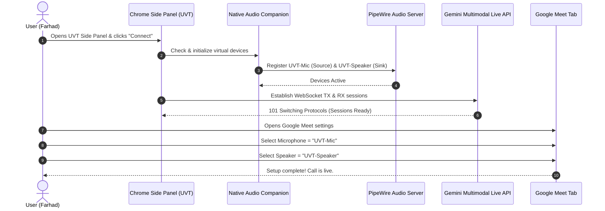
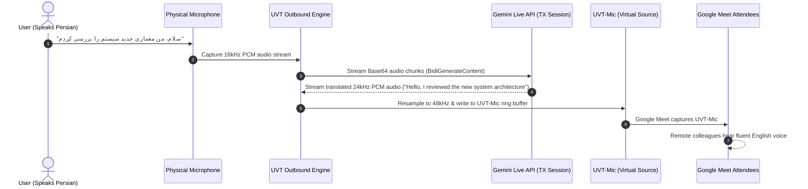
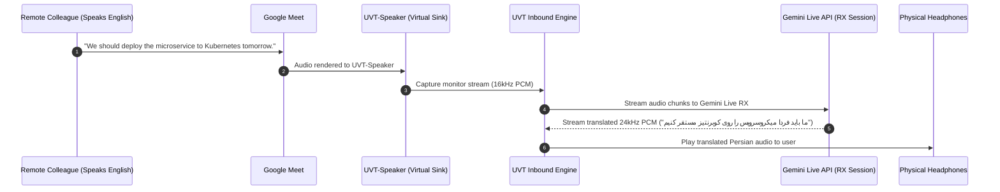

# UVT (Universal Voice Translator)
## Product Requirements Document (PRD) & Product Specification

- **Project Name:** UVT (Universal Voice Translator)
- **Document Version:** 1.0.0
- **Status:** Approved / Architecture Phase
- **Target Platform:** Google Chrome Extension (Side Panel API, Manifest V3) with Native Audio Engine (Linux PipeWire / Cross-Platform)
- **AI Core:** Google Gemini Multimodal Live API (Bidirectional Audio-to-Audio Realtime Streaming)

---

## 1. Executive Summary & Vision

### 1.1 The Vision
**UVT (Universal Voice Translator)** is an invisible, real-time, bidirectional voice translation companion built into Google Chrome as a **Side Panel application**. UVT eliminates the language barrier in remote work, virtual meetings, negotiations, and live audio conversations by translating speech instantaneously in full-duplex with natural vocal tone, emotional inflection, and sub-second latency.

Unlike legacy captioning or text-to-speech tools that require reading subtitles or waiting for awkward pauses, UVT works directly on the **audio hardware stream**. It introduces two virtual audio devices into the user's operating system:
1. **`UVT-Mic`**: A virtual microphone that presents the user's real-time translated voice to conferencing platforms (Google Meet, Zoom, Microsoft Teams, Discord, Slack).
2. **`UVT-Speaker`**: A virtual audio output that receives foreign speech from the meeting participants, translates it into the user's native language, and plays it privately into the user's real headphones or speakers.

```
+---------------------------------------------------------------------------------------+
|                                      UVT ECOSYSTEM                                    |
|                                                                                       |
|   [ Physical Mic ] ---> ( UVT TX: Gemini Live API ) ---> [ UVT-Mic ]                  |
|      (You speak)           (Translates fa -> en)           |                          |
|                                                            v                          |
|                                                    [ Google Meet / Zoom ]             |
|                                                    (Remote attendees hear             |
|                                                     fluent English voice)             |
|                                                            |                          |
|   [ Physical Speaker ] <-- ( UVT RX: Gemini Live API ) <-- [ UVT-Speaker ]            |
|     (You hear Persian)     (Translates en -> fa)       (Meeting outputs here)         |
+---------------------------------------------------------------------------------------+
```

### 1.2 Core Value Proposition
- **Invisible Integration:** Remote meeting participants do not need to install plugins or join external bots. To Google Meet or Zoom, `UVT-Mic` is simply another standard microphone, and `UVT-Speaker` is simply another speaker.
- **True Speech-to-Speech (S2S):** Powered by Google's **Gemini Multimodal Live API**, UVT streams audio directly token-by-token over WebSockets. This avoids the high latency, robotic monotone, and error accumulation of traditional 3-stage cascades (ASR $\rightarrow$ Machine Translation $\rightarrow$ TTS).
- **Zero-Friction Chrome Side Panel UX:** Docked right next to meeting tabs, providing real-time dual-language transcriptions, volume meters, language switching, voice customization, and push-to-talk overrides.

---

## 2. Problem Statement & Market Opportunity

| Challenge in Existing Solutions | Legacy Tool Impact | UVT Solution |
| :--- | :--- | :--- |
| **Cascade Latency (ASR $\rightarrow$ MT $\rightarrow$ TTS)** | Typical delay: 2.0s - 4.5s. Conversations feel disjointed and unnatural. | **Sub-second S2S streaming** (< 700ms) via Gemini Multimodal Live API. |
| **Robotic, Flat Prosody** | Synthesized TTS voices lack emotion, urgency, or conversational nuance. | **Gemini Live expressive speech** with human-like intonation and pitch matching. |
| **Meeting Bot Friction** | External translation bots (e.g., Zoom/Meet bots) require host approval, record rooms, and cause privacy concerns. | **Client-side Virtual Device:** No bots join the call; audio is translated locally before transmission. |
| **Window Clutter & Tab Juggling** | Separate desktop translation apps distract from meeting tabs and presentation slides. | **Chrome Side Panel:** Always docked alongside Google Meet, pinned without covering the video grid. |

---

## 3. User Personas

### Persona A: The Global Remote Software Engineer ("Farhad")
- **Role:** Senior Developer working for a US/EU tech firm.
- **Native Language:** Persian.
- **Working Language:** English.
- **Pain Point:** Understands technical English well when reading, but hesitates during high-stakes verbal architecture reviews or spontaneous standups due to accent anxiety and vocabulary recall.
- **Usage with UVT:** Farhad speaks naturally in his native tongue; `UVT-Mic` sends fluent, professional English to Google Meet. Incoming English from coworkers is translated into Persian in his headphones if he chooses, or he can run TX-only.

### Persona B: The Multilingual Executive / Sales Lead ("Elena")
- **Role:** Business Development Director pitching international clients in Tokyo and Berlin.
- **Native Language:** English.
- **Working Language:** Japanese / German.
- **Pain Point:** Hiring human simultaneous interpreters is prohibitively expensive (\$1,500/day) and requires booking days in advance.
- **Usage with UVT:** Runs full bidirectional mode. Japanese clients speak Japanese, which outputs to `UVT-Speaker` and translates to English in Elena's ears. Elena responds in English, which streams out through `UVT-Mic` in natural, polite Japanese.

---

## 4. Key Product Concepts & Terminology

| Term | Definition |
| :--- | :--- |
| **Chrome Side Panel** | A dedicated UI panel in Google Chrome introduced in Chrome 114+ that renders persistent web views alongside active browser tabs without obscuring page content. |
| **`UVT-Mic` (Outbound / TX)** | A virtual audio source (microphone) exposed to the host operating system. The conferencing app selects this as its microphone input. |
| **`UVT-Speaker` (Inbound / RX)** | A virtual audio sink (speaker) exposed to the host operating system. The conferencing app selects this as its audio output device. |
| **TX Stream (Transmit)** | The audio processing path from the user's physical microphone $\rightarrow$ Gemini Translation $\rightarrow$ `UVT-Mic`. |
| **RX Stream (Receive)** | The audio processing path from `UVT-Speaker` $\rightarrow$ Gemini Translation $\rightarrow$ user's physical headphones/speakers. |
| **Gemini Multimodal Live API** | Google's bidirectional WebSocket protocol (`BidiGenerateContent`) for low-latency streaming audio input and output. |
| **Native Companion Host** | A lightweight user-space daemon that interfaces with the host audio server (PipeWire/PulseAudio on Linux) to manage virtual device creation and sample routing. |

---

## 5. Functional Requirements (FR)

### 5.1 Chrome Side Panel User Interface
- **FR-01: Persistent Side Panel Docking:** The extension shall render inside Chrome's native Side Panel API (`chrome.sidePanel`), automatically adapting its layout to panel width changes (min 320px, optimal 400px).
- **FR-02: Stream Control Toggle:** Dedicated primary buttons to:
  - Start/Stop Translation Session (initializes/destroys audio connections).
  - Independent Mute/Pause controls for TX (My Mic) and RX (Remote Audio).
- **FR-03: Real-Time Dual Transcript Waterfall:**
  - Displays scrolling chronological speech bubbles with source text and translated text.
  - Color-coded bubbles: **Blue/Purple** for User (Outbound), **Green/Teal** for Remote Participants (Inbound).
  - Visual indicator showing "Translating..." with live audio waveforms.
- **FR-04: Language Pair Selectors:**
  - Dropdown for **User Native Language** (e.g., Persian, Spanish, German, French, Chinese, Japanese, etc.).
  - Dropdown for **Meeting Target Language** (e.g., English US/UK, etc.).
  - One-click "Swap Languages" button for quick turnaround.
- **FR-05: Gemini Voice & Persona Selector:**
  - Allows selecting the preferred Gemini voice for Outbound speech (`Puck`, `Charon`, `Kore`, `Fenrir`, `Aoede`).
  - Allows configuring translation tone presets: "Professional / Corporate", "Casual / Conversational", "Direct / Literal".
- **FR-06: Audio Level HUD:** Live visual VU/decibel meters for:
  - Real Microphone Input level.
  - `UVT-Mic` Output level.
  - `UVT-Speaker` Input level.
  - Real Headphone Output level.
- **FR-07: Pass-Through Mode:** A one-click toggle to bypass translation instantly, routing the Real Mic straight to `UVT-Mic` without AI processing when the user wants to speak the target language directly.

### 5.2 Audio Device & Routing Operations
- **FR-08: Virtual Device Initialization:**
  - On launch or session start, UVT shall ensure `UVT-Mic` (virtual input source) and `UVT-Speaker` (virtual output sink) exist and are registered with the OS audio server.
  - If devices are missing, UVT shall automatically create them via the native audio bridge without requiring root privileges or system restarts.
- **FR-09: Audio Device Health & Auto-Detection:**
  - Detects active audio streams and notifies the user if Google Meet or Zoom is not sending audio to `UVT-Speaker` or reading from `UVT-Mic`.
- **FR-10: Acoustic Echo Isolation:**
  - Audio routed to `UVT-Speaker` must NEVER leak back into `UVT-Mic` or the real microphone capture pipeline.
  - Strict isolation prevents recursive translation loops.

### 5.3 Gemini Live Translation Model Processing
- **FR-11: Dual Independent Gemini Live Sessions:**
  - UVT shall maintain **two separate WebSocket connections** to the Gemini Multimodal Live API:
    - *Session TX:* Local Mic $\rightarrow$ Target Translation.
    - *Session RX:* Remote Meeting Audio $\rightarrow$ Native Translation.
  - Separating sessions guarantees zero context contamination, eliminates hallucinated dialogues, and optimizes latency.
- **FR-12: Zero-Commentary Translation Enforcement:**
  - The Gemini translation model shall be configured with strict system instructions prohibiting conversational answers, chit-chat, explanations, or meta-comments.
  - The model outputs ONLY the translated audio stream.
- **FR-13: Native Barge-In & Interruption Handling:**
  - When the user starts speaking while their previous translation is still playing, UVT handles Gemini's `interrupted` event and flushes outdated buffers immediately to keep the conversation synchronized.
- **FR-14: Network Auto-Reconnect & Jitter Management:**
  - Automatic exponential backoff reconnection for WebSocket interruptions without terminating the virtual audio devices.

---

## 6. User Journeys & Operational Workflows

### Journey 1: Setup & Starting a Google Meet Call


### Journey 2: Outbound Speech Translation (Speaking into the Meeting)


### Journey 3: Inbound Speech Translation (Listening to Attendees)


---

## 7. Non-Functional Requirements (NFR)

### 7.1 Performance & Latency
- **End-to-End Latency Target:** $\le 750\text{ ms}$ from the end of a spoken clause to the start of translated speech delivery.
- **Audio Capture Chunk Interval:** $50\text{ ms} - 100\text{ ms}$ (800 to 1600 samples at 16kHz) to minimize framing delay.
- **CPU & Memory Footprint:**
  - Chrome Extension Side Panel: $< 150\text{ MB}$ RAM, $< 2\%$ CPU.
  - Native Audio Bridge Daemon: $< 80\text{ MB}$ RAM, $< 3\%$ CPU.

### 7.2 Audio Quality & Intelligibility
- **Sampling Rates:**
  - Capture & Upload to Gemini: 16,000 Hz, 16-bit Signed Integer PCM, Mono.
  - Download from Gemini: 24,000 Hz, 16-bit Signed Integer PCM, Mono.
  - OS Playback & PipeWire Sink: 48,000 Hz (standard PipeWire clock rate) via high-quality cubic/sinc resampling.
- **Speech Clarity:** Zero packet clicks, pop artifacts, or buffer underruns during live speaking bursts.

### 7.3 Security, Privacy & Compliance
- **Zero Local Storage of Audio:** Raw audio buffers must reside exclusively in transient RAM ring buffers and must never be written to persistent disk storage.
- **API Key Security:** API keys stored securely in Chrome `chrome.storage.local` or environment files with option for ephemeral session tokens.
- **Acoustic Privacy:** Inbound meeting audio is sent directly to Google Gemini's secure TLS WebSocket endpoint and is never broadcast or shared externally.

---

## 8. Release Roadmap & Milestones

| Milestone | Scope | Deliverables |
| :--- | :--- | :--- |
| **M1: Architecture & Design (Current)** | Complete PRD, Technical Specs, Audio Topology & Gemini Model Specs. | Documentation folder (`uvt-docs/`), system diagrams, protocol specs. |
| **M2: Native Audio Bridge (Linux PipeWire)** | Virtual device generator (`UVT-Mic`, `UVT-Speaker`) & loopback verification. | Python/Native bridge script registering nodes in PipeWire and verifying with `wpctl`. |
| **M3: Gemini Live Audio Engine** | Dual-session bidirectional WebSocket client with strict translation prompts. | Standalone audio streaming test script verifying sub-second voice translation. |
| **M4: Chrome Side Panel Extension** | Manifest V3 extension with Side Panel UI, VU meters, controls, and Native Messaging IPC. | Working Chrome Side Panel interacting with Native Host. |
| **M5: End-to-End Integration & Polish** | Full Google Meet live testing, barge-in tuning, latency HUD, transcript sync. | Production-ready package. |
