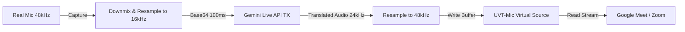

# UVT (Universal Voice Translator)
## System Architecture & Technical Specification

- **Project Name:** UVT (Universal Voice Translator)
- **Document Version:** 1.0.0
- **Architectural Pattern:** Hybrid Chrome Side Panel Extension (MV3) + Native Audio Bridge (PipeWire/ALSA)
- **Primary AI Protocol:** Gemini Multimodal Live API (Bidirectional WebSocket `BidiGenerateContent`)

---

## 1. High-Level Architectural Analysis

### 1.1 The Sandbox Challenge vs. Virtual Audio Reality
A critical architectural constraint must be understood when developing a Chrome Side Panel app that interacts with operating system audio:

> [!IMPORTANT]
> **Browser Sandbox Limitation:** Web browsers (Chrome, Edge, Firefox) run in sandboxed user-space processes. Web standard APIs (`navigator.mediaDevices`, Web Audio API) **can only consume and playback through existing OS audio devices**. Web APIs CANNOT create, register, or inject kernel- or OS-level virtual audio drivers (such as registering `UVT-Mic` as a system microphone for third-party apps like Google Meet, Zoom, or Slack).

If a Chrome Extension attempted to operate purely inside the browser sandbox:
1. Google Meet running in a separate tab or desktop Zoom would have no OS device named `UVT-Mic` to select as its microphone.
2. Google Meet's incoming attendee audio could not be piped into the extension unless the user manually selected an existing loopback device.

### 1.2 The Hybrid Architecture Solution
To achieve a seamless user experience where `UVT-Mic` and `UVT-Speaker` appear as first-class hardware devices in any conferencing app, UVT adopts a **Hybrid Architecture**:

```
+----------------------------------------------------------------------------------------------------+
|                                      HOST OPERATING SYSTEM                                         |
|                                                                                                    |
|  +----------------------------------+          IPC          +-----------------------------------+  |
|  |     CHROME SIDE PANEL (MV3)      |  <----------------->  |       UVT NATIVE COMPANION        |  |
|  |                                  |   (Native Messaging   |                                   |  |
|  |  * Persistent UI & Controls      |    or Local WS RPC)   |  * PipeWire Virtual Node Manager  |  |
|  |  * Live Dual Transcript Feed     |                       |  * DSP Engine & Ring Buffers      |  |
|  |  * Language & Voice Settings     |                       |  * Dual Gemini Live WS Clients    |  |
|  |  * VU Meters & Health Dashboard  |                       |  * Audio In/Out Streaming         |  |
|  +----------------------------------+                       +-----------------+-----------------+  |
|                                                                               |                    |
|                                               +-------------------------------+                    |
|                                               v                                                    |
|  +----------------------------------------------------------------------------------------------+  |
|  |                                PIPEWIRE 1.6+ AUDIO SUBSYSTEM                                 |  |
|  |                                                                                              |  |
|  |   [ Physical Mic ]                                                  [ Physical Speaker ]     |  |
|  |   (e.g., hw:1,0 HK 2M CAM)                                          (e.g., Built-in Stereo)  |  |
|  |          |                                                                    ^              |  |
|  |          v                                                                    |              |  |
|  |   ( Native Host Capture )                                           ( Native Host Playback ) |  |
|  |          |                                                                    ^              |  |
|  |          v (Gemini Live TX)                                                   | (Gemini RX)  |  |
|  |   [ UVT-Mic ] -----------------------------------------------\                |              |  |
|  |   (Virtual Source Node)                                       |      [ UVT-Speaker ]         |  |
|  |                                                               |   (Virtual Sink Node)        |  |
|  |                                                               v               ^              |  |
|  |                     +-------------------------------------------------+       |              |  |
|  |                     |        CONFERENCING APPLICATION (Meet / Zoom)   |       |              |  |
|  |                     |  * Input Mic = "UVT-Mic"                       |-------/              |  |
|  |                     |  * Output Speaker = "UVT-Speaker"               |                      |  |
|  |                     +-------------------------------------------------+                      |  |
|  +----------------------------------------------------------------------------------------------+  |
+----------------------------------------------------------------------------------------------------+
```

---

## 2. Component Breakdown

### 2.1 Component 1: Chrome Side Panel Extension (Frontend & Control Plane)
- **Manifest Version:** Manifest V3 (`"manifest_version": 3`).
- **UI Context:** Chrome Side Panel (`chrome.sidePanel`), docked alongside Google Meet tabs.
- **Responsibilities:**
  - Rendering responsive UI (language selection, Gemini voice selection, volume VU meters).
  - Streaming transcript display (color-coded speech bubbles).
  - Orchestrating session commands (Start, Stop, Mute, Pass-Through).
  - Securely storing API keys and configuration in `chrome.storage.local`.
  - Communicating with the Native Companion via Chrome Native Messaging (`chrome.runtime.connectNative`) or a authenticated local WebSocket RPC.

### 2.2 Component 2: UVT Native Audio Companion (Engine Core)
- **Runtime:** Lightweight user-space daemon (Python 3.12+ with `sounddevice`, `numpy`, `websockets`, managed via `uv`).
- **Responsibilities:**
  - **Virtual Device Lifecycle:** Automatically creates and destroys `UVT-Mic` and `UVT-Speaker` via PipeWire (`pw-loopback` / WirePlumber).
  - **Audio Stream Ingestion:**
    - Reads raw PCM from Real Physical Microphone.
    - Reads raw PCM from `UVT-Speaker` monitor stream.
  - **Gemini Live Client Management:**
    - Maintains two concurrent bidirectional WebSockets to Gemini Multimodal Live API.
    - Encodes/decodes audio chunks (16kHz PCM $\leftrightarrow$ 24kHz PCM $\leftrightarrow$ 48kHz OS format).
  - **Audio Delivery:**
    - Writes translated outbound audio into `UVT-Mic`.
    - Writes translated inbound audio into the Real Physical Speaker.
  - **IPC Server:** Emits audio levels, live transcriptions, and status updates to the Chrome Side Panel.

### 2.3 Component 3: PipeWire Virtual Audio Nodes
- **`UVT-Mic` (Virtual Source):**
  - Type: PipeWire Audio Source (`media.class = Audio/Source`).
  - Appears in system device menus as `UVT Microphone (Translated)`.
  - Conference apps (Google Meet) open this node as their input.
- **`UVT-Speaker` (Virtual Sink):**
  - Type: PipeWire Audio Sink (`media.class = Audio/Sink`).
  - Appears in system device menus as `UVT Meeting Speaker (Translate Target)`.
  - Conference apps (Google Meet) direct their output audio to this node.

---

## 3. End-to-End Audio Pipelines

### 3.1 Outbound Audio Pipeline (TX: My Voice $\rightarrow$ UVT-Mic)
1. **Audio Capture:** Real Mic captures user speech at 48,000 Hz, 16-bit stereo.
2. **Preprocessing & Resampling:**
   - Downmixed to mono.
   - Resampled via linear/cubic interpolation to **16,000 Hz, 16-bit Signed PCM (little-endian)**.
   - Chunked into 100ms frames (1,600 samples = 3,200 bytes).
3. **Upstream Streaming (WebSocket TX):**
   - Chunks base64-encoded and sent inside `realtime_input.media_chunks` payload to Gemini Live API.
4. **AI S2S Processing:**
   - Gemini Multimodal Live API processes speech tokens and synthesizes translated speech tokens using selected voice persona (`Puck`, `Charon`, etc.).
5. **Downstream Receiving:**
   - Server streams 24,000 Hz 16-bit PCM chunks in `server_content.model_turn.parts`.
6. **Postprocessing & Resampling:**
   - Resampled from 24,000 Hz to 48,000 Hz.
   - Pushed to the `UVT-Mic` playback ring buffer.
7. **Broadcast:**
   - Meeting app (Google Meet) captures `UVT-Mic`; remote attendees hear translated speech.



---

### 3.2 Inbound Audio Pipeline (RX: UVT-Speaker $\rightarrow$ Real Speaker)
1. **Audio Egress from Meeting:**
   - Google Meet renders remote participant audio into `UVT-Speaker` at 48,000 Hz.
2. **Monitor Capture:**
   - UVT Companion captures from `UVT-Speaker.monitor` source node.
3. **Preprocessing & Resampling:**
   - Downmixed to mono, resampled to 16,000 Hz 16-bit PCM.
   - Framed into 100ms chunks.
4. **Upstream Streaming (WebSocket RX):**
   - Transmitted to Gemini Live API RX session.
5. **AI S2S Processing:**
   - Gemini translates foreign speech into the user's native language.
6. **Downstream Receiving:**
   - Received as 24,000 Hz 16-bit PCM.
7. **Playback:**
   - Resampled to 48,000 Hz and written to Real Physical Speaker / Headphones.


---

## 4. Virtual Device Implementation on Linux (PipeWire 1.6+)

PipeWire natively supports creating virtual nodes dynamically using `pw-loopback` without root privileges.

### 4.1 Creating `UVT-Speaker` (Audio Sink)
A virtual sink that applications can output to, with a monitor source that UVT can read from:
```bash
pw-loopback \
  --name "UVT-Speaker-Daemon" \
  --capture-props='media.class=Audio/Sink node.name=UVT_Speaker node.description="UVT Meeting Speaker" audio.position=[FL FR]' \
  --playback-props='node.name=UVT_Speaker_Dummy node.description="UVT Speaker Sink End" node.passive=true'
```
*Result:* Creates an audio sink named `UVT_Speaker`. When Google Meet sends audio here, it is available on `UVT_Speaker.monitor`.

### 4.2 Creating `UVT-Mic` (Audio Source)
A virtual source (microphone) that applications can select as their input, fed by the UVT native bridge:
```bash
pw-loopback \
  --name "UVT-Mic-Daemon" \
  --capture-props='node.name=UVT_Mic_Feed node.description="UVT Mic Feed Input" node.passive=true' \
  --playback-props='media.class=Audio/Source node.name=UVT_Mic node.description="UVT Translated Microphone" audio.position=[FL FR]'
```
*Result:* Applications see `UVT_Mic` as an input microphone. UVT writes translated audio into `UVT_Mic_Feed`, which PipeWire forwards to `UVT_Mic`.

---

## 5. Chrome Extension Side Panel (Manifest V3) Specification

### 5.1 Extension File Structure
```
uvt-chrome-extension/
├── manifest.json                  # Manifest V3 configuration
├── background/
│   └── service-worker.js          # Background service worker & native messaging connection
├── sidepanel/
│   ├── sidepanel.html             # Main Side Panel UI
│   ├── sidepanel.css              # Custom styling / Tailwind output
│   └── sidepanel.js               # Side panel controller & state manager
├── native-host/
│   ├── install_host.sh            # Manifest registrar for Chrome Native Messaging
│   ├── com.uvt.audio_bridge.json  # Native messaging host manifest
│   └── uvt_daemon.py              # Native Python PipeWire & Gemini bridge
└── icons/
    ├── icon16.png
    ├── icon48.png
    └── icon128.png
```

### 5.2 Manifest V3 Blueprint (`manifest.json`)
```json
{
  "manifest_version": 3,
  "name": "UVT - Universal Voice Translator",
  "version": "1.0.0",
  "description": "Real-time speech-to-speech voice translation side panel powered by Gemini Live API and virtual audio routing.",
  "permissions": [
    "sidePanel",
    "storage",
    "nativeMessaging"
  ],
  "host_permissions": [
    "https://generativelanguage.googleapis.com/*"
  ],
  "background": {
    "service_worker": "background/service-worker.js"
  },
  "side_panel": {
    "default_path": "sidepanel/sidepanel.html"
  },
  "action": {
    "default_title": "Open UVT Side Panel"
  },
  "icons": {
    "16": "icons/icon16.png",
    "48": "icons/icon48.png",
    "128": "icons/icon128.png"
  }
}
```

---

## 6. IPC Protocol (Chrome Side Panel $\leftrightarrow$ Native Engine)

Communication between the Chrome Side Panel and the Native Audio Companion uses Chrome's standard **Native Messaging Protocol** (stdin/stdout with 32-bit native byte-order message length prefix, UTF-8 JSON payloads).

### 6.1 Control Messages (Chrome $\rightarrow$ Native Companion)

#### 1. `START_SESSION`
Initiates virtual devices, audio streams, and Gemini Live WebSocket sessions:
```json
{
  "command": "START_SESSION",
  "config": {
    "apiKey": "AIzaSy...",
    "model": "gemini-2.0-flash-exp",
    "tx": {
      "enabled": true,
      "sourceLanguage": "Persian",
      "targetLanguage": "English",
      "voiceName": "Puck",
      "realMicDevice": "default"
    },
    "rx": {
      "enabled": true,
      "sourceLanguage": "English",
      "targetLanguage": "Persian",
      "voiceName": "Aoede",
      "realSpeakerDevice": "default"
    }
  }
}
```

#### 2. `STOP_SESSION`
Gracefully closes Gemini WebSockets, clears audio buffers, and halts streams.
```json
{
  "command": "STOP_SESSION"
}
```

#### 3. `UPDATE_CONTROLS`
Dynamically adjusts live parameters (mutes, pass-through, volume gain):
```json
{
  "command": "UPDATE_CONTROLS",
  "txMuted": false,
  "rxMuted": false,
  "passThrough": false,
  "txGain": 1.0,
  "rxGain": 1.0
}
```

---

### 6.2 Telemetry & Event Messages (Native Companion $\rightarrow$ Chrome)

#### 1. `DEVICE_STATUS`
Notifies extension when virtual devices are active and ready:
```json
{
  "event": "DEVICE_STATUS",
  "status": "READY",
  "devices": {
    "uvtMic": "UVT_Mic (PipeWire Node 92)",
    "uvtSpeaker": "UVT_Speaker (PipeWire Node 93)"
  }
}
```

#### 2. `AUDIO_METRICS` (Emitted every 100ms)
Powers live VU meters in the Chrome Side Panel:
```json
{
  "event": "AUDIO_METRICS",
  "metrics": {
    "realMicRmsDb": -24.5,
    "uvtMicRmsDb": -18.2,
    "uvtSpeakerRmsDb": -22.1,
    "realSpeakerRmsDb": -16.4,
    "txLatencyMs": 520,
    "rxLatencyMs": 610
  }
}
```

#### 3. `TRANSCRIPT_CHUNK`
Emits real-time transcription of original and translated speech:
```json
{
  "event": "TRANSCRIPT_CHUNK",
  "stream": "TX",
  "sourceText": "سلام دوستان، روز بخیر",
  "translatedText": "Hello everyone, good day",
  "isFinal": true,
  "timestamp": 1730750400000
}
```

---

## 7. Fault Tolerance, Safety & Error Handling

| Failure Scenario | Detection Mechanism | Remediation & Self-Healing |
| :--- | :--- | :--- |
| **Gemini WebSocket Drops** | WebSocket `onclose` / `onerror` event. | Exponential backoff reconnect ($500\text{ms}, 1\text{s}, 2\text{s}$). Audio continues buffering in ring buffer; virtual nodes remain alive to prevent meeting dropouts. |
| **PipeWire Server Restarts** | Socket disconnect / broken pipe on audio stream. | Native host monitors PipeWire daemon, auto-recreates loopback nodes, and resumes audio routing without user intervention. |
| **Acoustic Feedback / Echo Loop** | System detects identical frequency signature between `UVT-Speaker` and Real Mic. | Real Mic processing incorporates dynamic gain thresholding and acoustic isolation. `UVT-Speaker` output is never routed back to physical microphone input. |
| **Barge-In / Interruption** | Gemini sends `interrupted: true` or local VAD detects user speaking over playback. | Immediate buffer purge on `UVT-Mic` output queue, canceling queued audio packets and keeping voice streams synchronized. |
| **Chrome Extension Closed** | Native messaging pipe receives `EOF` on `stdin`. | Daemon gracefully detaches virtual nodes or enters low-power standby mode. |
