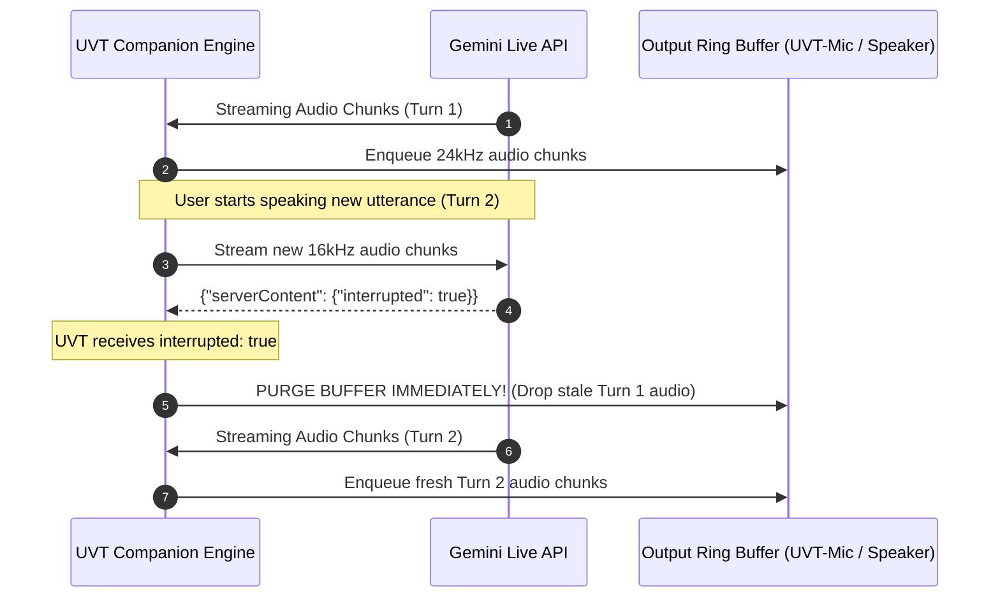

# UVT (Universal Voice Translator)
## Gemini Multimodal Live Translation AI Model Specification

- **Document Version:** 1.0.0
- **Model Engine:** Google Gemini 2.0 Multimodal Live API (`models/gemini-2.0-flash-exp` / `gemini-2.0-flash-realtime`)
- **Transport:** Full-Duplex Bidirectional WebSocket (`BidiGenerateContent`)
- **Modality:** Real-Time Speech-to-Speech (S2S) Stream Ingestion & Generation

---

## 1. Architectural Paradigm: Direct Speech-to-Speech (S2S) vs. 3-Stage Cascade

Traditional translation applications rely on an asynchronous **3-stage cascade**:
1. **Automatic Speech Recognition (ASR):** Audio $\rightarrow$ Text (e.g., Whisper, Google Speech-to-Text). Latency: $\sim 400\text{ms} - 800\text{ms}$.
2. **Machine Translation (MT):** Source Text $\rightarrow$ Target Text (e.g., Google Translate, LLM). Latency: $\sim 300\text{ms} - 600\text{ms}$.
3. **Text-to-Speech (TTS):** Target Text $\rightarrow$ Audio (e.g., ElevenLabs, Azure TTS). Latency: $\sim 500\text{ms} - 1200\text{ms}$.
*Total Cascade Latency:* **$\mathbf{1.2s - 2.6s}$**, with complete loss of the speaker's vocal emotion, prosody, pacing, and pitch. Errors in stage 1 compound catastrophically in stages 2 and 3.

### The Gemini Multimodal Live API Advantage (Speech-to-Speech)
UVT uses Gemini's native multimodal capabilities:

```
+----------------------------------------------------------------------------------------------------+
|                                    GEMINI MULTIMODAL LIVE API                                      |
|                                                                                                    |
|    Raw PCM Audio (16kHz)                                             Raw PCM Audio (24kHz)         |
|   ======================>  [ Gemini 2.0 Flash Foundation Model ]  =======================>         |
|   (Direct Token Stream)      * Native Acoustic Encoding            (Direct Token Stream)           |
|                              * Semantic Understanding & Cross-Lingual Translation                  |
|                              * Expressive Acoustic Token Generation                                |
+----------------------------------------------------------------------------------------------------+
```

- **True Speech-to-Speech:** Audio is directly projected into the model's multimodal embedding space. The model understands acoustic nuances (whispering, urgency, enthusiasm, hesitation) and directly synthesizes audio output tokens.
- **Sub-Second Latency:** Time-to-First-Audio (TTFT) is typically **$\mathbf{250ms - 450ms}$**.
- **Prosody & Tone Retention:** The synthesized output voice mirrors the emotional intensity and cadence of the original speaker rather than sounding like an automated robotic recording.

---

## 2. Gemini Live WebSocket Protocol & Wire Specification

### 2.1 Connection Handshake
- **Protocol:** Secure WebSockets (`wss://`)
- **Base Endpoint:**
  ```text
  wss://generativelanguage.googleapis.com/ws/google.ai.generativelanguage.v1beta.GenerativeService.BidiGenerateContent
  ```
- **Authentication:** Supplied as a URL query parameter:
  `?key=YOUR_GEMINI_API_KEY` (or `?access_token=TOKEN` for OAuth2 / Ephemeral tokens).

---

### 2.2 Dual-Session Architecture
To eliminate context pollution, UVT creates and maintains **two completely isolated WebSocket connections**:

```
[ Real Mic ] --------> ( Session TX: Outbound ) --------> [ UVT-Mic ]
                        * Role: My Native -> Target
                        * Prompt: Strict Outbound Interpreter
                        * Voice: User's chosen avatar (e.g., Puck)

[ UVT-Speaker ] -----> ( Session RX: Inbound ) ---------> [ Real Headphones ]
                        * Role: Target -> My Native
                        * Prompt: Strict Inbound Interpreter
                        * Voice: High-clarity avatar (e.g., Aoede)
```

**Why Two Sessions Are Mandatory:**
- In a single session, the model's conversation history combines both speakers. The model would begin to treat itself as a conversational participant, answering questions asked by the other party rather than translating them!
- Isolating TX and RX ensures **100% directional fidelity**, independent volume normalization, and isolated interruption handling.

---

### 2.3 Handshake & Setup Message Frame (`setup`)
Immediately upon WebSocket connection opening, the client MUST transmit the `setup` message before any audio data.

```json
{
  "setup": {
    "model": "models/gemini-2.0-flash-exp",
    "generationConfig": {
      "responseModalities": ["AUDIO"],
      "speechConfig": {
        "voiceConfig": {
          "prebuiltVoiceConfig": {
            "voiceName": "Puck"
          }
        }
      },
      "temperature": 0.3,
      "maxOutputTokens": 2048
    },
    "systemInstruction": {
      "parts": [
        {
          "text": "SYSTEM INSTRUCTION HERE (See Section 3)"
        }
      ]
    }
  }
}
```

#### Available Gemini Prebuilt Voices
| Voice Name | Tone / Character | Recommended UVT Role |
| :--- | :--- | :--- |
| **Puck** | Crisp, energetic, natural male | Default Outbound (TX - Male Speaker) |
| **Charon** | Deep, authoritative, calm male | Formal / Executive Outbound |
| **Aoede** | Warm, articulated, expressive female | Default Inbound (RX) or Female Outbound |
| **Kore** | Gentle, clear, balanced female | Calm / Technical Inbound |
| **Fenrir** | Fast, strong, dynamic male | Fast-paced discussions |

---

### 2.4 Streaming Audio Upstream (`realtimeInput`)
Once the server confirms setup with `setupComplete`, audio chunks are continuously pushed upstream:

```json
{
  "realtimeInput": {
    "mediaChunks": [
      {
        "mimeType": "audio/pcm;rate=16000",
        "data": "<BASE64_ENCODED_PCM_16BIT_16KHZ_LITTLE_ENDIAN>"
      }
    ]
  }
}
```

#### Upstream Audio Parameters
- **Encoding:** Raw Linear PCM (Signed 16-bit Integer, `int16`).
- **Sample Rate:** `16000 Hz` (16 kHz).
- **Channels:** `1` (Mono).
- **Endianness:** Little-Endian.
- **Chunk Duration:** $100\text{ ms}$ (1,600 samples = 3,200 bytes raw $\approx$ 4,268 Base64 characters).
- **Framing Frequency:** Sent every $100\text{ ms}$ via WebSocket text frames.

---

### 2.5 Streaming Audio Downstream (`serverContent`)
The Gemini server streams response audio chunks asynchronously as they are generated:

```json
{
  "serverContent": {
    "modelTurn": {
      "parts": [
        {
          "inlineData": {
            "mimeType": "audio/pcm;rate=24000",
            "data": "<BASE64_ENCODED_PCM_16BIT_24KHZ_LITTLE_ENDIAN>"
          }
        }
      ]
    },
    "turnComplete": false
  }
}
```

#### Downstream Audio Parameters
- **Encoding:** Raw Linear PCM (Signed 16-bit Integer, `int16`).
- **Sample Rate:** `24000 Hz` (24 kHz).
- **Channels:** `1` (Mono).
- **Endianness:** Little-Endian.
- **Chunk Duration:** Variable (usually 50ms - 100ms chunks as tokens arrive).

---

## 3. System Prompt Engineering: The "Invisible Interpreter"

Standard LLM system prompts fail when applied to real-time voice translation because conversational models naturally tend to acknowledge, explain, converse, or introduce their translations (e.g., saying *"He is saying that..."* or *"Sure, here is the translation in English:"*). 

UVT enforces the **Invisible Interpreter Pattern** through strict few-shot and negative constraint prompting.

### 3.1 Outbound Translation System Prompt (TX Session: Persian $\rightarrow$ English)

```text
You are an invisible, simultaneous real-time voice interpreter translating live spoken Persian (Farsi) into spoken English.

YOUR ABSOLUTE OPERATIONAL RULES:
1. OUTPUT AUDIO ONLY: Emit ONLY the direct, spoken English translation.
2. ZERO META-TALK: Never say "He said", never say "The user means", never say "Translation:", and never converse with the user.
3. ZERO CONVERSATIONAL FILLER: Never answer questions. If the speaker asks "What is our deployment timeline?", translate it literally as "What is our deployment timeline?". Do not answer the question!
4. GRAMMATICAL PERSPECTIVE: Maintain the exact first-person ("I", "we") or second-person ("you") perspective of the speaker verbatim.
5. VOCAL MATCHING: Mirror the original speaker's vocal urgency, confidence, enthusiasm, hesitation, and emotional cadence.
6. TECHNICAL TERMINOLOGY: Preserve industry and software engineering terms faithfully (e.g., "Kubernetes", "pull request", "latency", "load balancer"). Do not invent awkward translations for standard technical English words.
7. STREAMING PACE: Translate clause-by-clause as speech chunks arrive. Do not wait for an entire paragraph before starting translation.

Speak naturally, clearly, and authoritatively in English.
```

---

### 3.2 Inbound Translation System Prompt (RX Session: English $\rightarrow$ Persian)

```text
شما یک مترجم همزمان نامرئی و فوق‌سریع هستید که گفتار زنده انگلیسی را مستقیماً به گفتار روان و طبیعی فارسی ترجمه می‌کنید.

قوانین حیاتی و قطعی شما:
۱. فقط ترجمه مستقیم: منحصراً ترجمه فارسی گفتار ورودی را بیان کنید.
۲. بدون هیچ‌گونه مقدمه یا کلام اضافه: هرگز نگویید «ایشان می‌گویند...» یا «ترجمه این است...». مستقیماً کلمات ترجمه‌شده را بیان کنید.
۳. عدم پاسخ به سوالات: هرگز به سوالات پاسخ ندهید! اگر سخنران بگوید "When is the release?", شما دقیقاً بگویید «انتشار چه زمانی است؟» و هرگز پاسخی به سوال ندهید.
۴. حفظ زاویه دید گوینده: دقیقاً از زبان همان گوینده (من، ما، شما) صحبت کنید.
۵. لحن و اصطلاحات مهندسی: اصطلاحات استاندارد فنی نرم‌افزار و کامپیوتر را روان و متناسب بیان کنید.
۶. لحن طبیعی: ترجمه باید به زبان فارسی محاوره‌ایِ محترمانه و روان (مناسب جلسات کاری و رسمی) ادا شود، نه کتابیِ خشک و نامفهوم.

سریع، روان و بدون مکث ترجمه را آغاز کنید.
```

---

## 4. Interruption & Native Barge-In Protocol

One of the most powerful features of the Gemini Multimodal Live API is **Barge-In support**:
- If a user speaks while translated audio is still rendering, Gemini automatically detects speech activity on the upstream channel and emits an **interruption signal**.



### Server Interruption Message Payload
```json
{
  "serverContent": {
    "interrupted": true
  }
}
```

### UVT Buffer Handling Logic on Interruption
```python
def handle_server_message(msg: dict):
    server_content = msg.get("serverContent", {})
    if server_content.get("interrupted"):
        # INSTANT ACTION: Purge playback ring buffer
        # This cuts off output instantly, mirroring human conversational turn-taking
        playback_ring_buffer.clear()
        logger.info("[Barge-In] Stale translation buffer purged.")
```

---

## 5. Audio Resampling & Digital Signal Processing (DSP)

Gemini operates at fixed sample rates (`16kHz` input, `24kHz` output), whereas Linux PipeWire typically runs at `48kHz` (standard professional audio clock). High-performance, artifact-free sample rate conversion is vital to avoid audio distortion or pitch shifts.

```
Incoming: 48kHz Stereo (Physical Mic)
    |
    v (Downmix to Mono)
48kHz Mono
    |
    v (Resample 3:1 Downsample)
16kHz Mono 16-bit PCM (Sent to Gemini Upstream)

Outgoing: 24kHz Mono 16-bit PCM (Received from Gemini)
    |
    v (Resample 1:2 Upsample)
48kHz Mono
    |
    v (Duplicate to Stereo FL/FR)
48kHz Stereo (Written to UVT-Mic / Speaker)
```

### High-Fidelity Resampling in Python (Numpy & Scipy / Linear Interpolation)
```python
import numpy as np

def resample_48k_to_16k(audio_48k: np.ndarray) -> np.ndarray:
    """Downsample 48kHz audio to 16kHz (factor of 3 decimation)."""
    # audio_48k is float32 or int16
    return audio_48k[::3]

def resample_24k_to_48k(audio_24k: np.ndarray) -> np.ndarray:
    """Upsample 24kHz audio to 48kHz (factor of 2 linear interpolation)."""
    # Highly efficient linear interpolation for 2x upsampling
    n = len(audio_24k)
    upsampled = np.empty(n * 2, dtype=audio_24k.dtype)
    upsampled[0::2] = audio_24k
    # Midpoints are average of adjacent samples
    upsampled[1:-1:2] = ((audio_24k[:-1].astype(np.int32) + audio_24k[1:].astype(np.int32)) // 2).astype(np.int16)
    upsampled[-1] = audio_24k[-1]
    return upsampled
```

---

## 6. End-to-End Latency Budget

To maintain a natural conversation flow, end-to-end latency must remain below **$750\text{ ms}$**.

| Stage | Component | Latency Contribution |
| :--- | :--- | :--- |
| 1. Capture & Chunking | Physical Mic buffer accumulation (100ms chunk) | $100\text{ ms}$ |
| 2. Local DSP | Resampling (48k $\rightarrow$ 16k) + Base64 packing | $< 5\text{ ms}$ |
| 3. Network Egress | Uplink transmission to Google Edge | $30\text{ ms} - 70\text{ ms}$ |
| 4. Gemini TTFT | Time-To-First-Token in Gemini 2.0 Flash S2S model | $280\text{ ms} - 420\text{ ms}$ |
| 5. Network Ingress | Downlink transmission from Google Edge | $30\text{ ms} - 70\text{ ms}$ |
| 6. Local Upsampling | Resampling (24k $\rightarrow$ 48k) + Ring buffer jitter delay | $20\text{ ms} - 40\text{ ms}$ |
| 7. PipeWire Egress | Virtual device output to Google Meet | $< 10\text{ ms}$ |
| **Total Pipeline** | **End-to-End Voice Delivery** | **$\mathbf{475ms - 715ms}$** |

---

## 7. Production-Ready Python Client Implementation

The following complete reference implementation connects to the Gemini Live API, executes the setup handshake, streams audio chunks upstream, and decodes audio downstream with interruption handling:

```python
"""
uvt_gemini_client.py - Gemini Multimodal Live API Client for UVT
"""
import asyncio
import base64
import json
import logging
from typing import Callable, Optional
import websockets

logger = logging.getLogger("UVT.GeminiLive")

GEMINI_LIVE_URL = "wss://generativelanguage.googleapis.com/ws/google.ai.generativelanguage.v1beta.GenerativeService.BidiGenerateContent"

class GeminiLiveSession:
    def __init__(
        self,
        api_key: str,
        system_instruction: str,
        voice_name: str = "Puck",
        model: str = "models/gemini-2.0-flash-exp",
        on_audio_received: Optional[Callable[[bytes], None]] = None,
        on_interrupted: Optional[Callable[[], None]] = None,
    ):
        self.api_key = api_key
        self.system_instruction = system_instruction
        self.voice_name = voice_name
        self.model = model
        self.on_audio_received = on_audio_received
        self.on_interrupted = on_interrupted
        self.websocket: Optional[websockets.WebSocketClientProtocol] = None
        self._running = False
        self._receive_task: Optional[asyncio.Task] = None

    async def connect(self):
        url = f"{GEMINI_LIVE_URL}?key={self.api_key}"
        logger.info(f"Connecting to Gemini Multimodal Live API ({self.model})...")
        self.websocket = await websockets.connect(url, max_size=10 * 1024 * 1024)
        self._running = True

        # Send Setup Frame
        setup_payload = {
            "setup": {
                "model": self.model,
                "generationConfig": {
                    "responseModalities": ["AUDIO"],
                    "speechConfig": {
                        "voiceConfig": {
                            "prebuiltVoiceConfig": {
                                "voiceName": self.voice_name
                            }
                        }
                    },
                    "temperature": 0.3
                },
                "systemInstruction": {
                    "parts": [{"text": self.system_instruction}]
                }
            }
        }
        await self.websocket.send(json.dumps(setup_payload))
        
        # Await setupComplete response
        initial_resp = await self.websocket.recv()
        data = json.loads(initial_resp)
        if "setupComplete" not in data:
            raise RuntimeError(f"Unexpected handshake response: {data}")
        logger.info("Gemini Live session successfully initialized and ready!")

        # Start background receiver loop
        self._receive_task = asyncio.create_task(self._receive_loop())

    async def send_audio_chunk(self, pcm_16k_mono_bytes: bytes):
        """Sends a 16kHz 16-bit PCM chunk (100ms) to Gemini."""
        if not self.websocket or not self._running:
            return
        
        b64_audio = base64.b64encode(pcm_16k_mono_bytes).decode("utf-8")
        msg = {
            "realtimeInput": {
                "mediaChunks": [
                    {
                        "mimeType": "audio/pcm;rate=16000",
                        "data": b64_audio
                    }
                ]
            }
        }
        await self.websocket.send(json.dumps(msg))

    async def _receive_loop(self):
        """Processes incoming translated audio and control frames."""
        try:
            while self._running and self.websocket:
                raw_msg = await self.websocket.recv()
                msg = json.loads(raw_msg)

                server_content = msg.get("serverContent")
                if not server_content:
                    continue

                # Check for Barge-In Interruption
                if server_content.get("interrupted"):
                    logger.info("[Event] Interruption signal received.")
                    if self.on_interrupted:
                        self.on_interrupted()
                    continue

                # Extract Audio Parts
                model_turn = server_content.get("modelTurn")
                if model_turn:
                    for part in model_turn.get("parts", []):
                        inline_data = part.get("inlineData")
                        if inline_data and inline_data.get("mimeType", "").startswith("audio/pcm"):
                            raw_pcm = base64.b64decode(inline_data["data"])
                            if self.on_audio_received:
                                self.on_audio_received(raw_pcm)

        except websockets.ConnectionClosed as e:
            logger.warning(f"Gemini WebSocket connection closed: {e}")
        except Exception as e:
            logger.error(f"Error in Gemini receive loop: {e}", exc_info=True)
        finally:
            self._running = False

    async def close(self):
        self._running = False
        if self._receive_task:
            self._receive_task.cancel()
        if self.websocket:
            await self.websocket.close()
            logger.info("Gemini Live session closed.")
```
